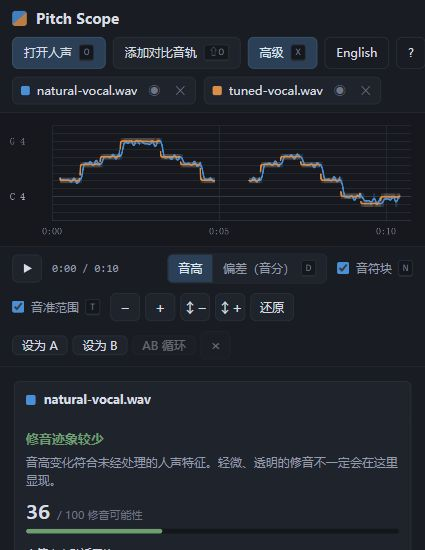
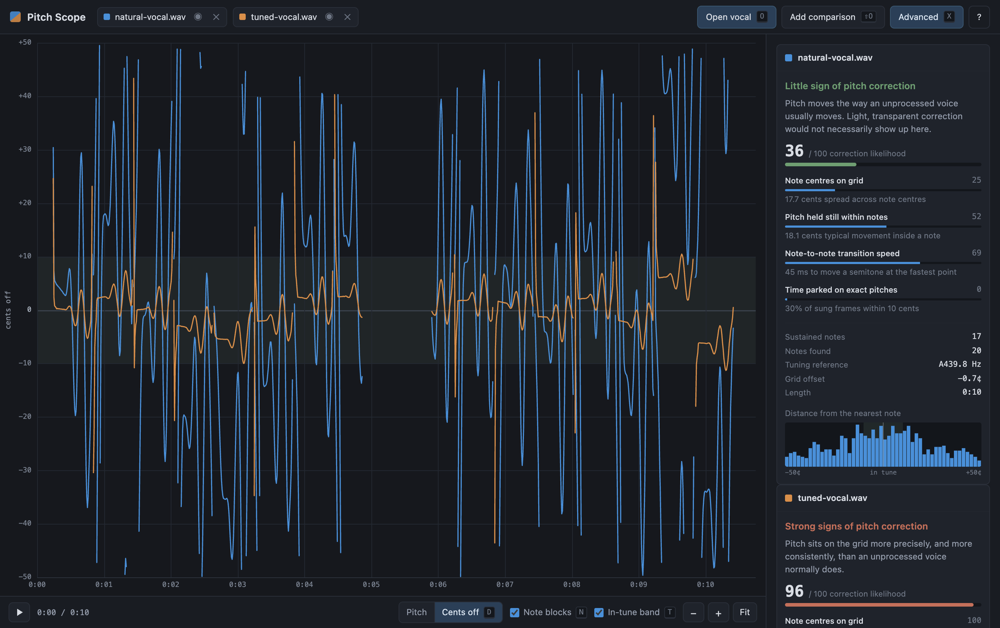

# Pitch Scope（简体中文）

语言： [English](README.md) | **简体中文**

Pitch Scope 是一个在浏览器中运行的人声音高分析工具。加载独立人声后，它会把演唱曲线绘制到半音网格上。加载第二段人声后，可以在同一张图中比较原唱与翻唱、自然演唱与修音版本。

所有分析都在浏览器本地完成，音频不会上传。



截图展示了中文界面、语言切换按钮、时间和音高范围控制，以及 A/B 循环控制。语言按钮会在中文和英文之间切换，并记住上一次选择。

## 功能特点

- 中文界面，音名保留 `C3`、`C5` 等标准表示。
- 同时显示两段人声的音高曲线和分析报告。
- 提供“音高”和“偏差（音分）”两种视图。
- 支持 A/B 区间循环播放。
- 支持时间轴缩放，以及音高范围的上下缩放和平移。
- 支持左键矩形选区缩放，并可一键还原默认视图。
- 支持 WAV、MP3、FLAC、M4A、AAC、OGG 等浏览器可解码格式。

## 在线试用

打开部署后的页面，在开始界面点击“加载示例对比”，即可加载同一句短语的自然演唱和强制修音示例。

## 本地运行

这是一个无需编译步骤和第三方依赖的静态网站，使用任意 HTTP 服务器即可运行：

```sh
git clone https://github.com/Fanghongzhe/pitch-scope.git
cd pitch-scope
npm start
```

然后打开 <http://localhost:8173>。

`npm start` 实际执行的是 `python3 -m http.server 8173`，也可以使用 `npx serve` 或 `php -S localhost:8173` 等等效命令。

不要直接双击打开 `index.html`。音频分析运行在模块化 Web Worker 中，浏览器只允许它通过 `http://` 或 `https://` 加载。

## 使用方法

1. 点击“打开人声”，按 <kbd>O</kbd>，或把音频文件拖到页面中。
2. 等待分析完成。四分钟左右的音轨通常只需几秒钟。
3. 查看曲线。左侧水平线代表半音，旁边标有音名。

建议使用独立人声、清唱或单独的人声音轨。完整混音中最响的乐器可能会被识别为目标声音。如果只有成品混音，建议先使用分轨工具提取人声。

### 两种视图

**音高**视图显示相对于钢琴卷帘网格的绝对音高。未经处理的人声会在网格线附近摆动、滑入音符并产生颤音；修音会使曲线更贴近网格线。

**偏差（音分）**视图（<kbd>D</kbd>）会减去最近的音符，把整段演唱映射到 −50 到 +50 音分范围。修音曲线通常贴近零线，自然演唱则会在更大的范围内变化。



### 对比两段演唱

按 <kbd>X</kbd> 打开高级模式，然后点击“添加对比音轨”（或按 <kbd>Shift</kbd>+<kbd>O</kbd>）选择第二个文件。两条曲线会分别以蓝色和琥珀色显示，并各自生成一份报告。

也可以一次把两个音频文件拖到页面中。按 <kbd>1</kbd> 或 <kbd>2</kbd> 可以显示或隐藏对应音轨。

### A/B 循环播放

在播放条下方：

1. 将播放位置放到起点，点击“设为 A”。
2. 将播放位置放到终点，点击“设为 B”。
3. 点击“AB 循环”开始或停止循环。

循环区间会以背景色和两条竖线标在曲线上；点击 × 可以清除区间。

### 画布操作

- **左键长按并拖动**：绘制矩形区域，松开后自动把时间轴和音高范围缩放到选区，并保留少量边距。
- **中键短按**：移动播放条位置。
- **中键长按并拖动**：平移时间轴和音高范围。
- **滚轮**：缩放时间轴；按住 `Alt` 可缩放音高范围，按住 `Shift` 可上下平移音高范围。
- **右键**：仅在本页面画布内禁用浏览器菜单，不影响其他页面。

## 键盘快捷键

| 按键 | 操作 |
| --- | --- |
| <kbd>O</kbd> | 打开人声音轨 |
| <kbd>Shift</kbd>+<kbd>O</kbd> | 添加对比音轨 |
| <kbd>Space</kbd> | 播放／暂停 |
| <kbd>←</kbd> <kbd>→</kbd> | 按时间平移，按住 <kbd>Shift</kbd> 加大步长 |
| <kbd>↑</kbd> <kbd>↓</kbd> | 上下移动音高范围 |
| <kbd>+</kbd> <kbd>−</kbd> | 缩放时间轴 |
| <kbd>0</kbd> | 还原默认视图 |
| <kbd>D</kbd> | 切换音高和音分偏差视图 |
| <kbd>N</kbd> | 显示或隐藏音符块 |
| <kbd>T</kbd> | 显示或隐藏音准范围 |
| <kbd>1</kbd> <kbd>2</kbd> | 显示或隐藏音轨 1、2 |
| <kbd>X</kbd> | 高级控制 |
| <kbd>?</kbd> | 查看快捷键说明 |

## 修音可能性报告

侧栏会根据四项独立指标给出 0 到 100 的统计分数，并显示每项指标的具体测量结果：

| 指标 | 含义 | 修音录音通常表现为 |
| --- | --- | --- |
| 音符中心贴近网格 | 音符中心的音分离散度 | 处于网格附近几音分以内 |
| 音符内部音高稳定度 | 持续音符内部的变化 | 曲线更平直，漂移和颤音减少 |
| 音符间过渡速度 | 音符变化处的最快斜率 | 在几十毫秒内快速切换 |
| 落在准确音高上的时间 | 位于容差范围内的帧比例 | 大部分时间停留在网格上 |

这个分数不是结论。精准的歌手、拼接录音或较短且恰好准确的片段，也可能得到较高分数。请结合试听，并尽量与另一段演唱进行比较。

## 高级设置

按 <kbd>X</kbd> 后打开“分析设置”：

- **音准容差**：判定曲线落在网格上的 ± 音分范围，只影响显示色带和直方图。
- **计入的最短音符**：更短的片段会被当作经过音而不是完整音符。
- **静音阈值**：低于主要响度多少会被视为静音。
- **人声范围**：限制到歌手的实际音域可以减少八度识别错误。

后三项设置改变后，会重新分析所有已加载音轨。

## 项目结构

| 文件 | 作用 |
| --- | --- |
| [`js/dsp.js`](js/dsp.js) | YIN 音高检测、静音门限、曲线清理 |
| [`js/music.js`](js/music.js) | 音符转换、调音参考估计、音符分段和指标计算 |
| [`js/worker.js`](js/worker.js) | 在后台线程执行分析并报告进度 |
| [`js/plot.js`](js/plot.js) | Canvas 曲线和网格绘制 |
| [`js/app.js`](js/app.js) | 文件加载、播放、交互和报告面板 |

## 测试

```sh
npm test
npm start
npm run test:browser
```

Node 测试覆盖音高准确度、静音检测、八度和尖峰清理、调音参考估计，以及自然演唱与修音演唱的区分。

## 部署

项目是静态网站，可以直接部署到 Cloudflare Pages、GitHub Pages 或其他静态托管服务。无需编译，直接把仓库根目录作为发布目录即可。

## 许可证

MIT，详见 [LICENSE](LICENSE)。
